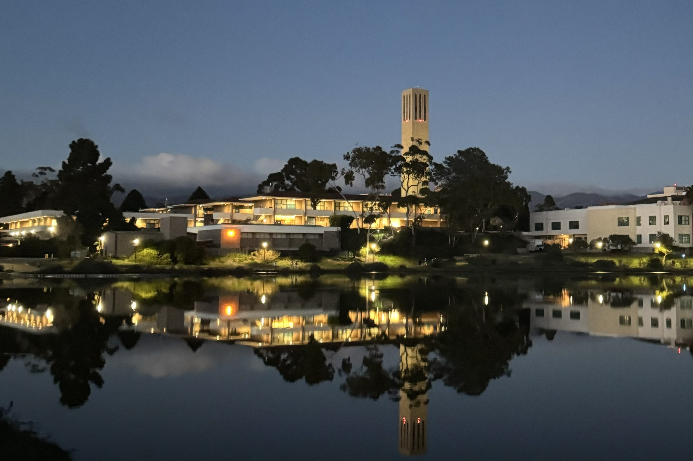

##### Hello!

I have a B.Sc. in Environmental Studies and a minor in Spatial Studies. I did most of bachelor's at University of California, Santa Barbara. I finished it while at Utrecht University in the Netherlands on a study abroad program.

My studies focused on ecological conservation and management, water resources, and spatial analysis with GIS. See the Education page in the top navbar for more details.

------------------------------------------------------------------------

{fig-align="left" width="6in"}

### Recent Positions 

I left two positions I held in Santa Barbara due to moving to the Netherlands. Being in Santa Barbara reminded me how much I love being and working outside.

I was a research assistant for the VEG lab at UCSB, where I would collect soil samples and plant coverage data. Hiking out to the research sites, my team would identify all the species we could see and determine the number of individuals and percent coverage in each sector. This position solidified how much I love field work and jobs like these keep me passionate for the field. In addition to the field work I would also collect plant measurement data in the lab greenhouse to track plant growth by treatment group over time.

I was also the Growing Grounds Coordinator for a non-profit called Your Children's Trees. In this position I oversaw the care of around 400 trees, mostly Coast live oak. While providing and adjusting the care of the trees, I also coordinated weekly events where I delegated and taught volunteer groups of 1-15 people in order to maximize their learning and completing tasks. This position helped me bridge the gap between restoration science and connection to the community. I learned a lot from my supervisor, Ken Knight, and will always value my time I spent at the Harder Growing Grounds.
